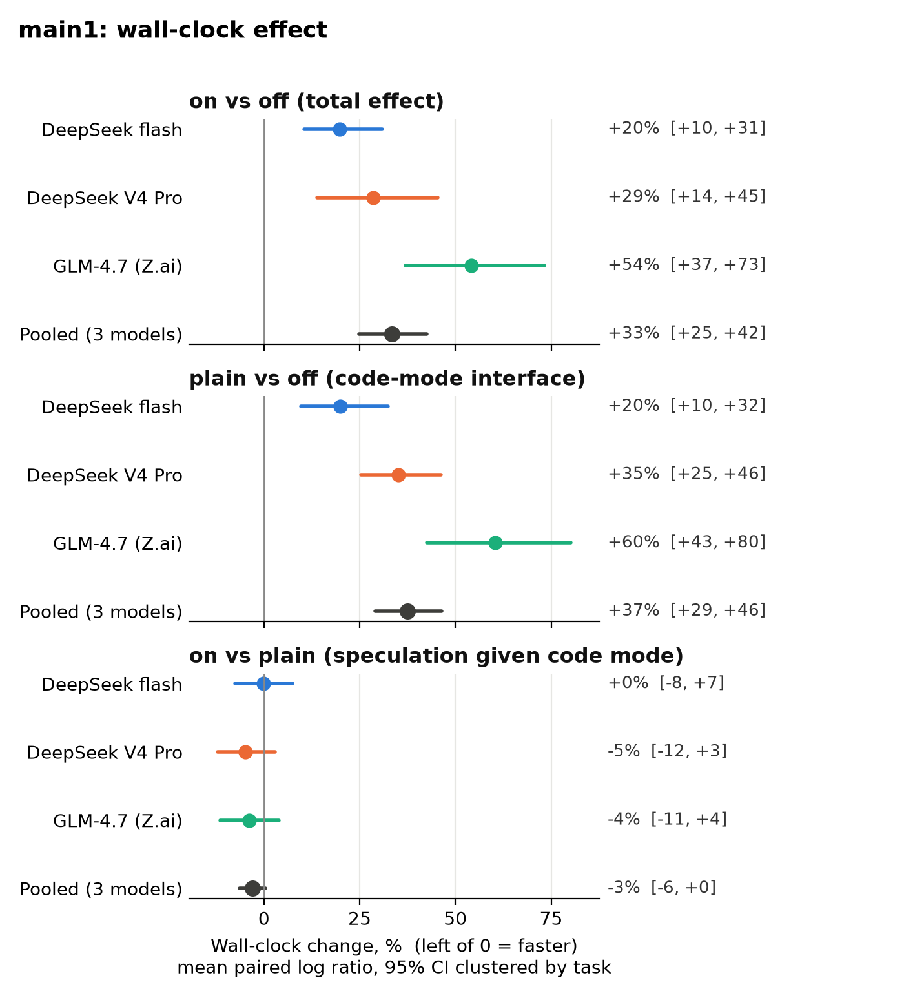
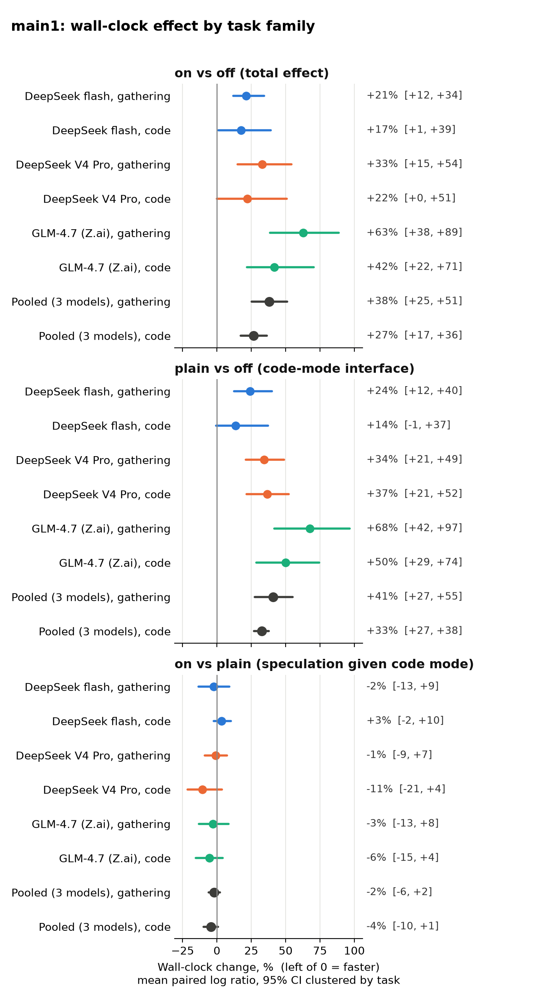

# Results: code-puppy speculative code mode, batch main1

On 20 short read-and-edit tasks across three models, enabling code-puppy 0.0.896's speculative
code mode made runs 20% to 54% slower (95% CIs all above zero); the cost is the run_code
interface adding model round-trips, and speculation itself recovered at most a few percent
because the models wrote one tool call per snippet.

code-puppy 0.0.896, three models through a local LiteLLM proxy, 20 tasks (12 gathering, 8 code
change), three arms, three reps: 540 runs, all valid. Analysis follows the frozen plan in
`docs/PLAN.md`, including its rule that a run ending in `run_code` max-retry exhaustion is a task
failure (see RQ2). Every number below comes from `scripts/analyze_main1.py`; the full tables are
in `docs/results/main1_tables.md` and the machine-readable output in
`docs/results/main1_summary.json`. An adversarial audit of an earlier draft, by a separate Claude model, is in
`docs/audit/AUDIT_main1.md`; this version applies its required changes.

Arms:
- **off**: native tools, speculation off (code-puppy default).
- **on**: `enable_speculative_code_mode = true`. This turns on code mode (tools folded into a
  `run_code` sandbox) AND speculation.
- **plain**: code mode with speculation and eager execution disabled (our plugin), so
  on vs plain isolates speculation and plain vs off isolates the code-mode interface.

Effects are the mean of per-(task, rep) paired log wall-clock ratios, shown as % change with a
95% bootstrap CI clustered by task (10,000 resamples, seed 20261011). Positive = slower.

## Headline (RQ1): speculation on made runs slower, not faster

| model | on vs off | plain vs off | on vs plain |
|---|---|---|---|
| DeepSeek flash | +19.8% [+10.5, +30.9] | +19.9% [+9.7, +32.5] | -0.1% [-7.5, +7.5] |
| DeepSeek V4 Pro | +28.5% [+13.8, +45.3] | +35.2% [+25.3, +46.2] | -4.9% [-12.2, +2.9] |
| GLM-4.7 (Z.ai) | +54.1% [+37.0, +73.3] | +60.3% [+42.5, +80.2] | -3.9% [-11.5, +4.0] |
| Pooled (3 models) | +33.4% [+24.8, +42.5] | +37.5% [+29.1, +46.5] | -3.0% [-6.3, +0.3] |

n = 60 pairs per model (20 tasks x 3 reps), 180 pooled. The pooled row weights the three models
equally, so GLM-4.7 pulls it up.

- Turning the switch on slowed every model, with every CI above zero: about 20% for flash,
  29% for V4 Pro, 54% for GLM-4.7. In seconds, the mean on-minus-off difference is +3.7 s
  (flash), +7.3 s (V4 Pro) and +35.2 s (GLM-4.7).
- The slowdown is the code-mode interface. Code mode without speculation (plain) is just as
  slow or slower than on.
- Speculation itself, holding code mode fixed, is within noise: pooled -3.0% [-6.3, +0.3], and
  no single model's CI excludes zero. GLM-4.7 shows -3.9% even though none of its 1,173 tool-call
  parts in arms on and plain streamed any argument deltas, so speculation had nothing to start
  early. A difference of that size therefore arises without any speculation at all; treat about
  plus or minus 4% per model as the noise floor of this design.



Typical run lengths (geometric mean wall, seconds): flash 15.1 off / 18.1 on / 18.2 plain;
V4 Pro 25.2 / 32.4 / 34.1; GLM-4.7 58.1 / 89.5 / 93.1.

## Mechanism: more model round-trips, same latency per round-trip

| model | arm | requests per run | mean request s | mean time to first token s | prompt tokens per request | model time per run s |
|---|---|---|---|---|---|---|
| DeepSeek flash | off | 6.1 | 1.51 | 0.50 | 6,921 | 9.2 |
| DeepSeek flash | on | 8.0 | 1.58 | 0.54 | 9,443 | 12.6 |
| DeepSeek flash | plain | 8.0 | 1.52 | 0.53 | 9,336 | 12.1 |
| DeepSeek V4 Pro | off | 6.7 | 3.53 | 0.56 | 9,230 | 23.6 |
| DeepSeek V4 Pro | on | 9.0 | 3.38 | 0.55 | 10,804 | 30.6 |
| DeepSeek V4 Pro | plain | 9.9 | 3.35 | 0.58 | 11,006 | 33.0 |
| GLM-4.7 (Z.ai) | off | 6.2 | 8.68 | 6.09 | 6,461 | 53.8 |
| GLM-4.7 (Z.ai) | on | 10.1 | 8.59 | 6.96 | 8,499 | 87.1 |
| GLM-4.7 (Z.ai) | plain | 11.2 | 8.20 | 6.76 | 8,447 | 91.7 |

From the proxy's own request rows (all 540 runs). Per-request latency does not change with the
arm; the number of requests per run does, and so does the context resent with each one. The
code-mode cost is a per-turn tax, so it scales with the model's per-turn latency: GLM-4.7 spends
about 6 to 7 s before its first token on every request, and about four extra requests at about
8.6 s each is close to its +35.2 s on-minus-off difference.

Wrapped tool calls per `run_code` snippet (tool executions seen by the post-tool hook between
consecutive `run_code` completions; speculative launches included, native `create_file` /
`replace_in_file` excluded):

| model | arm | snippets | snippets per run | mean wrapped calls | 0 | 1 | 2 | 3 | 4+ |
|---|---|---|---|---|---|---|---|---|---|
| DeepSeek flash | on | 455 | 7.6 | 1.10 | 29% | 52% | 11% | 4% | 5% |
| DeepSeek flash | plain | 442 | 7.4 | 1.00 | 31% | 52% | 11% | 4% | 2% |
| DeepSeek V4 Pro | on | 545 | 9.1 | 1.02 | 22% | 69% | 4% | 3% | 3% |
| DeepSeek V4 Pro | plain | 557 | 9.3 | 1.03 | 22% | 69% | 4% | 2% | 3% |
| GLM-4.7 (Z.ai) | on | 516 | 8.6 | 1.12 | 21% | 60% | 10% | 6% | 3% |
| GLM-4.7 (Z.ai) | plain | 585 | 9.8 | 0.95 | 31% | 55% | 6% | 6% | 3% |
| Pooled | on | 1,516 | 8.4 | 1.08 | 23% | 61% | 8% | 4% | 3% |
| Pooled | plain | 1,584 | 8.8 | 0.99 | 28% | 59% | 7% | 4% | 3% |

The 0.0.896 code-mode guidance tells the model to "Go BIG in one `run_code` call" with ten to
thirty tool calls per snippet. None of the three models did: about one wrapped call per snippet,
one snippet per turn. Each snippet is then a full model round-trip, which is where the extra
requests come from, and speculation has almost no runway to overlap anything.

## RQ2: success rate is at ceiling, no pre-registered test detects a difference

| model | off | on | plain |
|---|---|---|---|
| DeepSeek flash | 59/60 (0.98) [0.91, 1.00] | 59/60 (0.98) [0.91, 1.00] | 60/60 (1.00) [0.94, 1.00] |
| DeepSeek V4 Pro | 60/60 (1.00) [0.94, 1.00] | 56/60 (0.93) [0.84, 0.97] | 60/60 (1.00) [0.94, 1.00] |
| GLM-4.7 (Z.ai) | 58/60 (0.97) [0.89, 0.99] | 59/60 (0.98) [0.91, 1.00] | 60/60 (1.00) [0.94, 1.00] |
| Pooled | 177/180 (0.98) [0.95, 0.99] | 174/180 (0.97) [0.93, 0.99] | 180/180 (1.00) [0.98, 1.00] |

Wilson 95% CIs. **Regrading applied per the frozen rule:** `docs/PLAN.md` ("Valid run") counts
`run_code` max-retry exhaustion as a task failure. Two runs (V4 Pro and GLM-4.7, c3, on, rep 2)
ended with `Tool 'run_code' exceeded max retries count of 3` after they had already fixed the
bug, so the hidden tests pass and the grader marks them correct. The analysis applies the plan's
rule and counts both as failures (the grader's verdict is kept in the data as `correct_raw`; on
was 176/180 under the grader alone). Both runs stay in every timing comparison, as valid runs
do under the plan. That is conservative for the headline: the V4 Pro one aborted at 40.9 s
against 89.8 s for its off pair, the most on-favourable pair in the data set.

Exact McNemar on discordant pairs (pre-registered: on vs off, plain vs off): on vs off pooled
3 pairs where only on was correct vs 6 where only off was, p = 0.508; V4 Pro 0 vs 4, p = 0.125;
GLM-4.7 2 vs 1, p = 1.000; flash 1 vs 1, p = 1.000. Plain vs off pooled 3 vs 0, p = 0.250. With
9 failures in 540 runs these tests have almost no power: they could not detect anything short of
a large quality change. Not pre-registered, and one of many comparisons in this report: on vs
plain pooled is 0 vs 6, p = 0.031 (4 of the 6 are V4 Pro, 2 are the regraded max-retry runs).
That is a hint that arm on failed more often than plain, not a finding.

The 9 failures: 6 wrong answers on gathering tasks, 1 run (V4 Pro, g1, on, rep 2) that found the
right values but omitted the required `ANSWER:` prefix (a failure under the frozen grader, which
is the same in every arm), and the 2 max-retry runs above.

## RQ3: cost goes up with code mode

Paired ratios from the proxy's own rows (on vs off). Dollars throughout are proxy-computed $
(LiteLLM price table, cache discounts applied); this repo cannot verify that price table.

| model | input tokens | output tokens | requests | proxy $ |
|---|---|---|---|---|
| DeepSeek flash | +74.5% [+53.5, +101.7] | +22.3% [+6.9, +39.7] | +29.1% [+15.4, +46.0] | +27.7% [+18.2, +37.8] |
| DeepSeek V4 Pro | +73.8% [+42.2, +112.3] | +33.6% [+15.1, +56.3] | +34.8% [+16.7, +54.4] | +29.9% [+15.1, +47.4] |
| GLM-4.7 (Z.ai) | +122.1% [+88.0, +164.0] | +55.4% [+36.9, +75.8] | +62.5% [+38.0, +90.1] | +79.5% [+59.9, +103.3] |
| Pooled | +88.9% [+71.1, +108.8] | +36.4% [+26.9, +46.9] | +41.4% [+29.9, +53.9] | +43.9% [+35.0, +53.6] |

Plain vs off looks the same (pooled $ +47.4% [+38.6, +56.6]); on vs plain is flat (pooled $
-2.4% [-5.9, +1.2]). Code mode makes the agent take more turns and resend more context.

Proxy-computed $ per solved task (max-retry runs counted as unsolved, per the plan):

| model | off | on | plain |
|---|---|---|---|
| DeepSeek flash | $0.00204 | $0.00262 | $0.00259 |
| DeepSeek V4 Pro | $0.01188 | $0.01558 | $0.01519 |
| GLM-4.7 (Z.ai) | $0.01008 | $0.01739 | $0.01787 |
| Pooled | $0.00801 | $0.01180 | $0.01188 |

(CIs for each cell are in the tables file.) Total main1 spend: $1.42 off, $2.05 on, $2.14 plain.

## RQ4: the speculation counters explain almost none of the timing

Arm on, all 180 runs: 1,324 hits, 19 misses, 9 wasted; 179 of 180 runs had at least one hit.
The one run without a hit (V4 Pro, r1_rich_box, rep 1) used code mode with the flag on; its model never
wrote a call speculation could start early.

| model | `saved_ms` sum, s | `eager_saved_ms` sum, s | wall sum, s | saved share of wall | saved + eager share of wall | mean on minus plain, s | mean on minus off, s |
|---|---|---|---|---|---|---|---|
| DeepSeek flash | 4.5 | 7.22 | 1,182 | 0.38% | 0.99% | +0.1 | +3.7 |
| DeepSeek V4 Pro | 6.5 | 3.87 | 2,325 | 0.28% | 0.44% | -2.9 | +7.3 |
| GLM-4.7 (Z.ai) | 5.7 | 0.07 | 5,927 | 0.10% | 0.10% | -5.6 | +35.2 |
| Pooled | 16.7 | 11.16 | 9,434 | 0.18% | 0.30% | -2.8 | +15.4 |

Per run, `saved_ms` is a median 0.18% of wall clock (max 1.30%). The counters are documented
lower bounds on hidden tool latency; together they come to 0.30% of wall clock. Tool calls in
these tasks are fast local reads, and the models put about one call in each snippet (see
Mechanism), so there is little latency to hide. The on-vs-off delta (+15.4 s per run) points the
other way and is driven by the interface.

## RQ5: gathering vs code

| comparison | family | flash | V4 Pro | GLM-4.7 | pooled |
|---|---|---|---|---|---|
| on vs off | gathering | +21.4% [+12.0, +34.3] | +33.0% [+15.1, +54.3] | +62.9% [+38.5, +88.7] | +38.0% [+25.4, +51.2] |
| on vs off | code | +17.5% [+1.1, +39.2] | +22.1% [-0.2, +50.8] | +41.8% [+21.7, +70.5] | +26.7% [+17.2, +36.3] |
| on vs plain | gathering | -2.3% [-13.5, +9.1] | -1.0% [-9.0, +7.4] | -2.8% [-13.0, +8.4] | -2.0% [-6.1, +2.2] |
| on vs plain | code | +3.4% [-2.3, +10.1] | -10.6% [-21.4, +3.5] | -5.5% [-15.4, +4.2] | -4.4% [-9.9, +0.8] |

The maintainer expected gathering to benefit most. In this data gathering is where turning
speculation on hurt most (pooled +38%), because the code-mode cost is largest there. The
speculation-only effect is within noise in both families.



## RQ6: reliability

| arm | error-like tool results (runs with any) | retry prompts | run_code max-retry failures | 429s | timeouts |
|---|---|---|---|---|---|
| off | 167 (80 of 180) | 7 | 0 | 0 | 0 |
| on | 397 (139 of 180) | 215 | 2 | 0 | 0 |
| plain | 397 (139 of 180) | 217 | 0 | 0 | 0 |

"Error-like tool results" is the plugin's heuristic (result has `success=False`, a non-empty
`error` field, or text starting with "error" / "traceback"). What they are:

| kind | off | on | plain |
|---|---|---|---|
| run_code snippet raised or was rejected | 0 | 198 | 204 |
| grep given a file path, not a directory | 103 | 89 | 79 |
| shell command failed (non-zero exit) | 37 | 41 | 49 |
| read_file: file over 10,000 tokens refused | 0 | 34 | 24 |
| read_file: file does not exist | 7 | 12 | 17 |
| native tool called by name inside code mode | 0 | 19 | 13 |
| grep: missing path or bad pattern | 13 | 4 | 8 |
| tool arguments rejected (extra field) | 7 | 0 | 0 |
| other | 0 | 0 | 3 |

In off, the errors are ordinary tool misuse that every arm shares: mostly `grep` pointed at a
file where it expects a directory, plus shell commands that exit non-zero. The extra errors in
code mode are almost all `run_code` snippets failing. Retry prompts (the error text sent back to
the model, each costing a round-trip) show why:

| kind | off | on | plain |
|---|---|---|---|
| tool result used as the wrong type (str / dict / object) | 0 | 64 | 33 |
| sandbox: sys.path unavailable | 0 | 32 | 36 |
| sandbox: stdlib module not importable (subprocess, ast, importlib, ...) | 0 | 26 | 24 |
| native tool called by name inside code mode | 0 | 22 | 19 |
| sandbox: Path.glob / Path.rglob unavailable | 0 | 15 | 25 |
| other runtime error in the snippet | 0 | 17 | 21 |
| snippet rejected by the type check | 0 | 5 | 16 |
| file not found | 0 | 8 | 12 |
| snippet syntax error | 0 | 8 | 11 |
| tool arguments rejected (extra field) | 7 | 5 | 6 |
| sandbox: os.walk / os.getcwd / asyncio.sleep unavailable | 0 | 7 | 7 |
| sandbox: project package not importable | 0 | 6 | 7 |

These are limits of the `run_code` sandbox (no `sys.path`, `subprocess`, `ast`, `Path.rglob`,
`os.walk`; the project's own packages not importable) and the models' stdlib habits running
into them, plus models indexing a tool's string result as a dict and calling native tool names
(`grep`, `read_file`) that code mode no longer exposes. They are not harness crashes. They are a
real cost of the interface, and speculation adds nothing on top. The two max-retry exhaustions
were both in arm on. Per-model counts are in the tables file.

Invalid attempts (all retried successfully): 3 clock stalls (V4 Pro off, GLM-4.7 off, GLM-4.7
on) and 1 proxy failure (V4 Pro on). The runner's record flag for a clock stall is named
`slept` because it was written on a Mac, where it caught system sleep: it fires when wall-clock
epoch time advances more than 2 s beyond the monotonic timer during a run. The bench host does
not sleep; here the three flagged gaps are 2.61 to 2.71 s and none is near a power-off (see Run
integrity).

## Sensitivity checks

Reported, not used to pick headlines. Pooled, % change [95% CI]:

| check | on vs off | plain vs off | on vs plain |
|---|---|---|---|
| primary (mean of log ratios) | +33.4% [+24.8, +42.5] | +37.5% [+29.1, +46.5] | -3.0% [-6.3, +0.3] |
| correct-only pairs | +34.8% [+26.0, +44.1] | +36.8% [+28.8, +45.3] | -1.8% [-5.3, +1.4] |
| excluding first block per worker | +33.1% [+24.4, +42.4] | +37.0% [+28.3, +46.4] | -2.8% [-6.3, +0.6] |
| median instead of mean | +27.1% [+21.1, +35.0] | +35.3% [+23.8, +47.9] | -3.1% [-8.9, -0.2] |
| excluding the recovered record | +33.5% [+24.9, +42.6] | +37.8% [+29.5, +46.7] | -3.0% [-6.3, +0.3] |
| excluding the 3 outage-split blocks | +33.2% [+24.6, +42.4] | +36.8% [+28.6, +45.6] | -2.6% [-6.0, +0.7] |
| agent time only (not pre-registered) | +42.0% [+30.9, +54.2] | +47.3% [+36.4, +59.8] | -3.6% [-7.6, +0.4] |

Every check gives the same story per model too (tables file). "First block" is block 0 of each
worker's queue. The two relaunches that started runs each gave every worker a new first block
after an outage; this check does not cover those, the outage-split row does. The median row's on vs plain CI ends just below
zero (-0.2%). That is one of about 100 intervals in this report (3 comparisons x 4 groups x
several families, cost metrics and sensitivity variants), and the pre-registered mean estimate
does not exclude zero, so it is not evidence of a speculation effect. Agent time only (wall
minus process boot and teardown) is shown because the fixed boot cost dilutes percentages; it
makes the code-mode cost larger, not smaller.

## Run integrity

The batch did not run in one go. Everything below is in the committed runner logs
(`runs/main1/batch.json`, `runs/main1/matrix.log`, `runs/main1.log`) and in the "Run history"
section of the tables file. Times are local (UTC-4).

- **16 launches of the runner, 3 of which started runs.** Launch 1 at 21:12.
- **Two hard power-offs of the bench VM.** The first at about 21:55 (last log line 21:55:18).
  The relaunch at 21:56 finalized 12 run dirs that had finished without a record yet and resumed
  with 263 records.
- The second at about 22:11 (last log line 22:10:31; it left a run of NUL bytes in
  `matrix.log` and at the start of one `records.jsonl` line). **Crash loop:** the 13 launches from
  22:13 to 22:37 each died at startup with `JSONDecodeError` reading a zero-byte `partial.json`
  (V4 Pro, r4_rich_progress, rep 1, plain, attempt 1; every file in that attempt dir except
  `capture.json` is zero bytes). Commit 979fdb7 made resume skip torn partials; the launch at
  22:39 finalized 8 more run dirs, skipped the torn partial so that cell re-ran, and resumed with
  322 records. The bench sat idle for about 28 minutes.
- **550 attempt dirs, 544 records.** The 6 dirs without a record are 5 attempts killed in flight
  by the power-offs (only `prompt.txt`, `stdout.raw`, `stderr.raw` present: flash f1 r2 on,
  V4 Pro f4 r1 off, V4 Pro g4 r1 off, GLM-4.7 c1 r3 on, GLM-4.7 f1 r3 plain) plus the torn one.
  All 6 cells were re-run as attempt 2 and are valid. Ten valid cells are on attempt 2: these 6
  plus the 4 invalid-attempt retries in RQ6.
- **3 blocks had their arms split across an outage** (started under different launches):
  V4 Pro r4_rich_progress rep 1, GLM-4.7 c1_click_intrange_clamp rep 3, GLM-4.7
  f1_invkit_total_value rep 3. Excluding them changes nothing (sensitivity table: on vs off
  +33.2% [+24.6, +42.4] pooled).
- **The NUL-prefixed recovered record.** Line 315 of `records.jsonl` starts with 1,147 NUL bytes
  (the torn tail of the second power-off) and, with no newline in between, carries the valid
  record for V4 Pro, h4_httpx_defaults, rep 2, arm off: a run that completed just before the
  power-off and was finalized on resume. A plain per-line `json.loads` would drop it and make
  that cell look missing; the runner's reader (`run_matrix.load_records`) strips NULs, which is
  why it never re-ran the cell. The analysis uses the runner's reader and shows the result
  without that record as a sensitivity check (no change).

## Data

- `runs/main1/records.jsonl` (committed): 544 lines, all parsed by the runner's reader, 540
  valid cells of 540 expected. **No cell is missing.**
- `runs/main1/run_extract.jsonl` and `runs/main1/attempt_dirs.txt` (committed): per-attempt
  request timings, snippet sizes and error kinds, and the attempt-dir listing, extracted from
  the run dirs by the analysis script. With them the script reproduces every table from the repo
  alone.
- The raw per-run dirs (`runs/main1/proxy-*/`: transcripts, plugin captures, proxy rows,
  stdout, grader output; about 90 MB) are not committed. They are kept by the author and are
  available on request.
- All runs on host `bench` (desktop, WSL), AC power, code-puppy 0.0.896.
- Cost metrics use proxy-side fields, which exist for all 540 runs. The agent's usage.json is
  missing for the 2 max-retry runs and differs by one request in 6 runs (requests attributed to
  a neighbouring run by time window); totals are unaffected.
- `grader.touched_tests` lists `tests/__pycache__/*.pyc` for 90 code runs. That is pytest
  bytecode, not an edit by the agent; no run touched a real test file. No leaks, no gathering
  run modified its repo, no subagents.

## Limitations

- **Short tasks.** Runs last 8 to 293 s and their tool calls are fast local reads, greps and
  small shell commands; there are no builds, test suites or network calls. The maintainer's
  hypothesis is that the biggest gains come from hiding long blocking tool calls; this suite does
  not test that. It shows only that the interface cost exists before any such gain can start.
  The code-mode cost on that kind of workload may shrink or grow and is not measured here.
- **No model followed the guidance.** The 0.0.896 guidance asks for many tool calls per
  snippet; all three models wrote about one. A model that does batch calls could change both the
  cost and the gain.
- **GLM-4.7 is a forced-thinking model** with about 6 to 7 s to first token on every request
  through Z.ai, so its percentage is a per-turn tax on an expensive turn. It also does not stream
  tool-call arguments through LiteLLM (`docs/FEASIBILITY.md`), so it gets no generation overlap
  and its on vs plain number cannot measure speculation.
- **Arm plain** is our plugin's reconstruction of code mode without speculation, not a shipped
  code-puppy option, and it still carries the code-mode guidance prompt, which says "Speculation
  is on". It is the right control for isolating early execution, but the prompt is identical to
  arm on.
- **Configuration:** headless `-p` mode, `--yolo`, MCP disabled, universal constructor disabled.
  Interactive TUI sessions, MCP servers (which code mode also folds) and longer multi-step work
  were not measured.
- **Scope:** three models (DeepSeek flash, DeepSeek V4 Pro, GLM-4.7), all through one local
  LiteLLM proxy, on a single host; one code-puppy version (0.0.896); Python repos only (click,
  httpx, rich, a fixture). No Anthropic, OpenAI or Gemini model.
- Success sits at the ceiling (531 of 540 correct), so RQ2 has very low power.
- Process boot and teardown (a few seconds) are inside wall clock, as pre-registered.
- The run was interrupted by two hardware power-offs (see Run integrity); the sensitivity checks
  show no effect on the results.

## Reproduce

```
cd /path/to/cp-spec-ab
uv venv .venv-analysis
uv pip install --python .venv-analysis/bin/python numpy matplotlib
.venv-analysis/bin/python scripts/analyze_main1.py runs/main1/records.jsonl
```

Tested with numpy 2.5.4 and matplotlib 3.11.2. Outputs land in `docs/results/`; the run takes
a few seconds and is deterministic (seed 20261011). The script reads `records.jsonl`,
`batch.json`, `run_extract.jsonl` and `attempt_dirs.txt` from `runs/main1/`; when the per-run
dirs are present it rebuilds the last two from them first.
